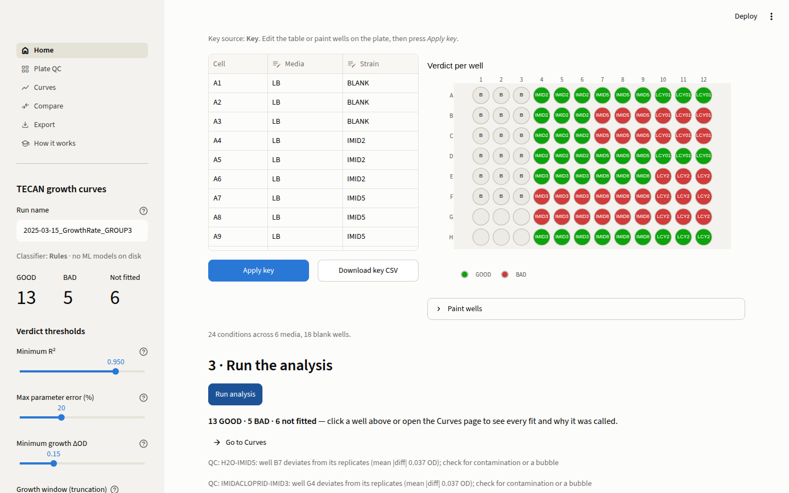
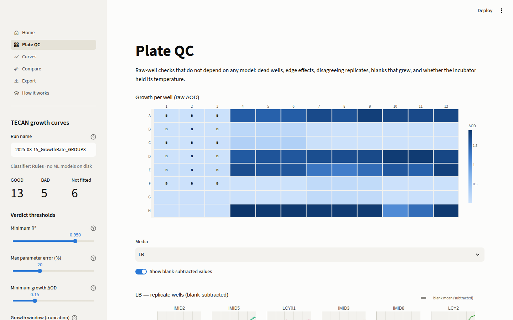
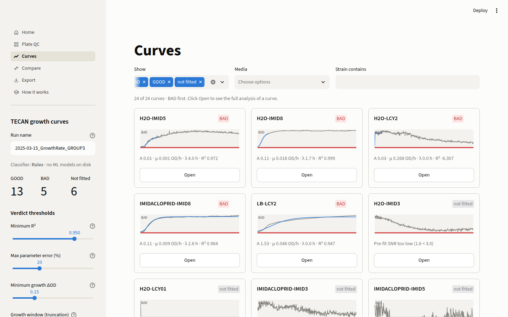
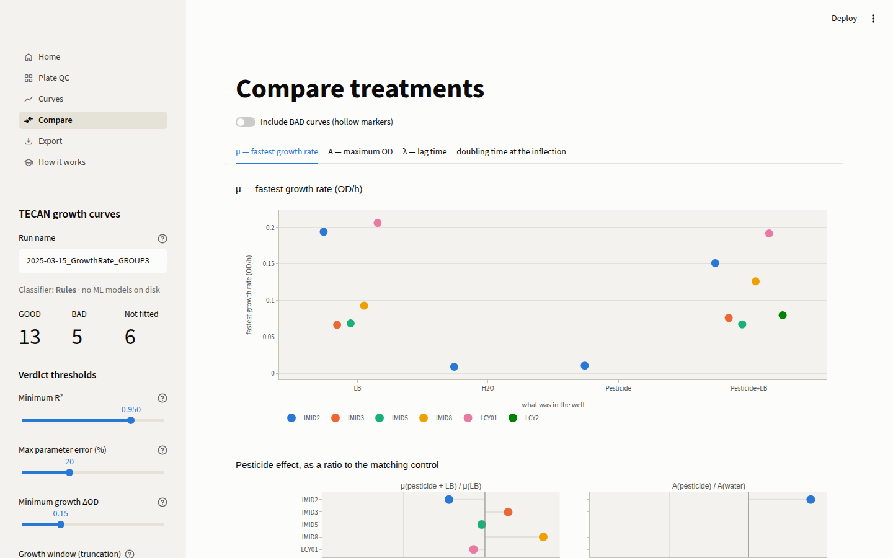

# TECAN Growth Curve Analysis Pipeline

Turn a TECAN Spark plate-reader export into growth parameters you can
trust, with a point-and-click interface for the bench and a scripted
pipeline for the paper.

For every strain × media condition on a 96-well plate the software
subtracts the media blank, averages the replicates, finds where primary
growth ends, fits the modified Gompertz model, and decides whether the fit
can be believed. It reports the maximum OD (**A**), the maximum growth rate
(**μ**), the lag time (**λ**) and the doubling time, with standard errors
and the reason behind every GOOD or BAD call.


## Start in 60 seconds

```bash
git clone https://github.com/dbold23/TECAN-Growth-Curve-Analysis-Pipeline.git
cd TECAN-Growth-Curve-Analysis-Pipeline
make install          # pip install -r requirements.txt (Python 3.10 to 3.12)
make app              # opens the lab interface in your browser
```

Press **Try the example plate** on the Home page. The plate loads with its
key, the grid shows what is in every well, and **Run analysis** gives a
verdict for all 24 conditions in a few seconds.

For your own plate: drop the SparkControl `.xlsx` (or the `Values` CSV) and
a key file with `Cell, Media, Strain` columns. The bench-side checklist is
in [docs/LAB_PROTOCOL.md](docs/LAB_PROTOCOL.md).

## The interface

| Page | What you do there |
|---|---|
| **Home** | Load the export and the key, fix the key in place, see the plate layout, run the analysis |
| **Plate QC** | Δ OD heat map of every well, temperature trace, verdict grid: is the plate itself sound? |
| **Curves** | One card per condition, BAD first. Fit, residuals, the gate that failed, "Show the math". Drag the window and refit, exclude a replicate, overrule a verdict with a note |
| **Compare** | μ, A, λ and doubling time of every GOOD condition, relative to each strain's LB control; ANOVA and Kruskal-Wallis |
| **Export** | Results CSV, report-ready summary, long-format curves, methods paragraph, and a zip bundle with a manifest that can be reloaded |
| **How it works** | The manual, with the thresholds of the current settings filled into the text |

<table>
<tr>
<td></td>
<td></td>
</tr>
<tr>
<td></td>
<td></td>
</tr>
</table>

Every threshold is a slider in the sidebar. Gates that do not need a refit
re-evaluate instantly; a change to the window rule marks the run stale
and offers a re-run. Every manual override is stored with a note and a
timestamp and travels with the export.

## The science in brief


1. **Preprocess.** Time in hours; per media, `OD = max(mean(replicates) − mean(blanks), 0)`.
2. **Find the growth window.** A 5-point rolling mean locates the first
   peak: where the growth rate falls through 25 % of the curve's fastest
   rate, above half the maximum OD. Three points past it are kept. A curve
   still rising in its last 15 % is kept whole. Alternatives: global
   maximum, or a Monte-Carlo cross-validated search (the rule used for the
   published tables, about 100× slower and fully deterministic). The 25 %
   was calibrated on the human-audited verdicts of the four included plates
   (83 of 85 agree).
3. **Fit** `y(t) = A·exp(−exp((μe/A)(λ − t) + 1))` (Zwietering et al. 1990)
   by non-linear least squares with data-driven starting values and
   bounds; standard errors from the covariance matrix; doubling time
   `ln2·A/(μe)` at the inflection point.
4. **Gate.** Fit converged; R² ≥ 0.95; A and μ errors ≤ 20 %; total rise
   ≥ 0.15 OD; A above 3× the baseline noise. Unless the fit is excellent
   (R² ≥ 0.98): signal-to-noise ≥ 5, rise significant against 2σ,
   monotone fraction ≥ 0.55 inside the window, residual autocorrelation
   at a 1 h lag ≤ 0.7.


The full explanation, with worked figures and the limits of what the
numbers mean, is in [docs/HOW_IT_WORKS.md](docs/HOW_IT_WORKS.md).


## Batch mode from the command line

The same code runs the published multi-group pipeline:

```bash
python scripts/run_full_pipeline.py --dry-run             # list the steps
python scripts/run_full_pipeline.py --steps 0,2,3 --no-ml # preprocess, fit every group, combine
python scripts/run_full_pipeline.py                       # everything in scripts/config.yaml
```

| Step | Script | What it does |
|---|---|---|
| 0 | `02_preprocess_raw_plate_data.py` | Raw export + key → one CSV per media (same code as the app) |
| 1 | `09_train_classifier.py` | Train the optional ML second opinion on synthetic curves (the audited real curves are held out as a test set) |
| 2 | `01_growth_curve_analysis.py` | Window, Gompertz fit, gates, diagnostic plots, per group |
| 3 | `03_statistical_analysis.py` | Combine groups, doubling times, ANOVA, figures |
| 4 | `05_haldane_analysis.py` | Haldane substrate-inhibition ODE vs Gompertz by AICc |
| 5 | `06_advanced_fitting.py` | Gaussian-process truncation, bootstrap CIs, ensemble, Bayesian models |
| 6 | `03_mle_model_fitting.py` | Multi-model maximum likelihood (Gompertz, Baranyi, logistic, Richards) |
| 7 | `07_compare_truncation_methods.py` | Rank five window rules per strain; rescue BAD strains |
| 8 | `04_export_for_collaboration.py` | Clean summary table and methodology text |
| 9 | synthetic validation | Run the pipeline on generated curves with known answers |

Steps 4 to 6 need `requirements-advanced.txt` (PyMC, ArviZ). Thresholds,
group folders and file names live in `scripts/config.yaml`; the app and
the scripts read the same file.

## What is in the repository

```
app/                 Streamlit interface (Home.py, views/, sidebar.py, state.py)
tecan_growth/        The library: io, plate key, preprocess, settings, analyze, plots, export, manual
scripts/             Numbered pipeline steps, run_full_pipeline.py, config.yaml, make_docs_figures.py
data/raw/            Four plates (Groups 1-4) as SparkControl exports, keys and processed CSVs
results/tables/      Committed outputs of the batch pipeline for the four groups
synthetic_data/      Generator and validation suite of curves with known parameters
tests/               pytest suite: readers, preprocessing, numerics, golden regression, app, docs
docs/                HOW_IT_WORKS.md, LAB_PROTOCOL.md, DESIGN_SPEC.md, how_it_works/, images/
```

### Included data

| Plate | Pesticides | Conditions | Export format |
|---|---|---|---|
| Group 1 | Bifenthrin, Flupyradifurone, Lambda-cyhalothrin | 24 | Values CSV + key CSV |
| Group 2 | Malathion, Lambda-cyhalothrin | 24 | xlsx with key sheet |
| Group 3 | Imidacloprid, Lambda-cyhalothrin | 24 | xlsx with key sheet (the app's example) |
| Group 4 | Permethrin, Lambda-cyhalothrin | 20 | xlsx with key sheet |

Each plate holds LB and water controls plus pesticide alone and pesticide
+ LB for each strain, in triplicate with blanks per media.

## How well does it work?

Two checks, both re-runnable, both committed with their outputs.

**Against the lab's own judgement.** The four included plates were audited
by eye (`results/tables/validation_audit.csv`: 85 conditions with a
confident call, recorded against the verdicts of an earlier version of
the pipeline). The interactive default rule (first peak) reproduces 74 of
those 85 calls. Eight of the eleven differences are wells that rose by
only 0.05 to 0.13 OD, mostly water controls, which that earlier version
accepted and the present minimum-growth gate (0.15 OD) rejects; the other
three are curves whose fit is below the R² line. Against the verdicts the
committed results tables carried before this work (a later version, with
that gate), the rule agrees on 83 of 85, and it was calibrated on that
comparison: the 25 % peak-rate threshold gave 83, a stricter 10 % gave 75.

**Against curves with known answers.** `make step-9` runs the pipeline on
480 synthetic curves from 32 scenarios (`synthetic_data/`). With the
first-peak rule the verdict is right for 87 % of them, with 90 % precision
and 93 % recall, and the recovered parameters track the truth with
R² of 0.98 (A), 0.91 (μ) and 0.98 (λ). Every miss is concentrated in five
scenarios, and the summary in
`synthetic_data/output/comprehensive_test/VALIDATION_SUMMARY.md` lists
them. Three of those scenarios define "BAD" by the R² of a fit to the
whole 99-hour trace, whereas the pipeline fits the growth window, where
R² is 0.96 to 0.99, so it accepts them; the other two are logistic-shaped
curves the Gompertz model flags as a shape mismatch, and hourly-sampled
curves that leave fewer than the 20 points the default window minimum
asks for. Lower that minimum in the sidebar for hourly data.

## Testing

```bash
make test                       # the whole suite
python -m pytest tests -q -k "not app"   # skip the browser-level checks
```

The suite checks that the readers reproduce every committed processed CSV
bit for bit, that the library gives the same numbers as the command-line
script, that the adaptive window search is deterministic, that the manual
renders with every placeholder resolved, and that the app starts and runs
the example plate without an exception. CI runs it on Python 3.10, 3.11
and 3.12 on every push.

## Citing

The growth model is the modified Gompertz equation of Zwietering, M. H.,
Jongenburger, I., Rombouts, F. M., & van 't Riet, K. (1990). *Modeling of
the bacterial growth curve.* Applied and Environmental Microbiology, 56(6),
1875–1881. Every export contains a `methods.md` paragraph with the
thresholds that were actually used and a `run_manifest.json` with the
commit, package versions and input checksums.

Developed for BIO380 (Pesticide-Bioremediating Bacteria), CSU Monterey Bay.
Detailed background on the batch pipeline: [PIPELINE_METHODOLOGY.md](PIPELINE_METHODOLOGY.md)
and [scripts/README.md](scripts/README.md).
