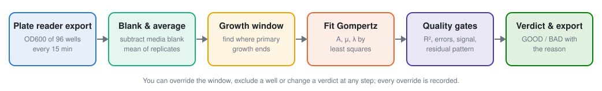
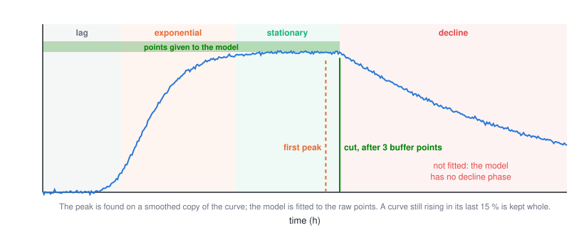
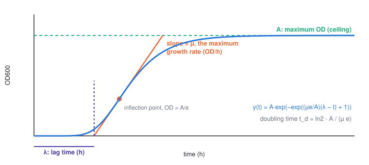
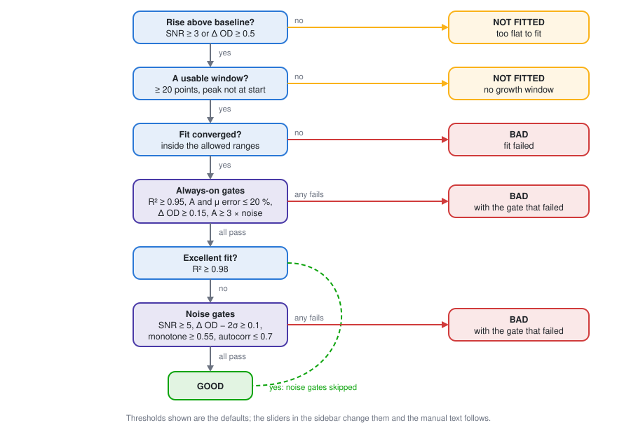
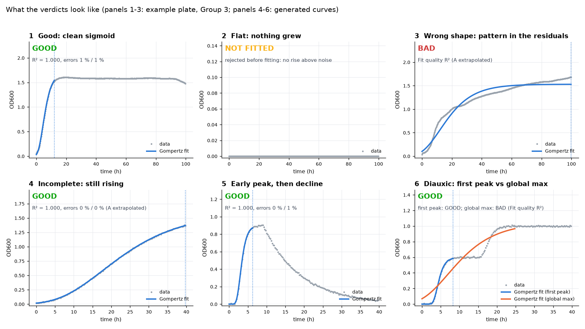

# How the analysis works

This is the lab manual for the TECAN growth-curve pipeline, rendered with
the **default** thresholds. The same text appears in the app under *How it
works*, where the numbers follow whatever settings are currently applied.
Edit the sections in `docs/how_it_works/` and run
`python -m tecan_growth.manual` to refresh this file.

## Contents

1. [What is measured](#what-the-plate-reader-measures)
2. [Preprocessing](#preprocessing-from-raw-wells-to-one-curve-per-condition)
3. [Growth window](#growth-phases-and-the-fitting-window)
4. [The model](#the-model-modified-gompertz)
5. [Fitting](#fitting-how-the-three-numbers-are-found)
6. [Fit quality](#fit-quality-does-the-model-actually-describe-the-curve)
7. [The verdict](#the-verdict-good-or-bad)
8. [Gallery](#gallery-what-the-calls-look-like)
9. [Comparing treatments](#comparing-treatments)
10. [Limits](#what-the-software-cannot-tell-you)
11. [Reproducibility](#reproducibility-and-citation)


---

## What the plate reader measures



The TECAN Spark shines light at 600 nm through each well of a 96-well plate and
reports how much is absorbed. Bacteria scatter that light, so the reading, the
**optical density at 600 nm (OD600)**, rises as the culture grows. The reader
takes one reading per well every cycle (typically every 15 minutes) for the
whole run, which gives a time series of about 100 to 400 points per well.

Three things matter for how the numbers are read later:

- **OD600 is not a cell count.** It is proportional to biomass only over
  roughly 0.05 to 1.0 OD and flattens above that. The analysis compares
  curves against each other, so a consistent reader setting matters more
  than the absolute value.
- **The medium absorbs light too.** Rich broth (LB) alone reads 0.03 to 0.10 OD,
  and a pesticide suspension can be cloudy. That is why every media type
  needs its own **blank wells**: medium with no cells. Their reading is
  subtracted from every culture well of that media (next section).
- **One well is one measurement.** Three wells of the same strain in the same
  media (**triplicates**) are averaged, and the spread between them tells you
  how repeatable the result is. A curve built from one well cannot show that.

### What the software needs from you

| Input | Where it comes from | What it is used for |
|---|---|---|
| The SparkControl export (`.xlsx`) or a `Values` CSV | The reader's software | Time, temperature and the OD600 of every well |
| A plate **key** (`Cell, Media, Strain` per well) | You, or the `KEY` sheet of the export | Which wells are replicates, which are blanks, what each well contains |

Wells whose strain is `Blank` (any capitalisation) are blanks. Wells marked
`NA`, `empty` or left out of the key are ignored. Two wells with the same
media and strain are treated as replicates of the same condition.


---

## Preprocessing: from raw wells to one curve per condition

Every condition on the plate (one media, one strain) becomes a single curve
in three steps. Nothing else is done to the data before fitting; in
particular the raw points are **never smoothed** before the model sees them.

### 1. Time in hours

The reader records time in seconds since the start of the run:

$$t_{\mathrm{h}} = \frac{t_{\mathrm{s}}}{3600}$$

### 2. Blank subtraction, per media

At every time point, the mean of the blank wells **of the same media** is
subtracted from every culture well of that media:

$$\mathrm{OD}_{\mathrm{blanked}}(t) = \max\big(\,\overline{\mathrm{OD}_{\mathrm{replicates}}}(t) - \overline{\mathrm{OD}_{\mathrm{blanks}}}(t),\; 0\big)$$

The current setting is **`per_media`** blanks. `per_media` uses the blank
wells of that media only; `global` uses every blank well on the plate (use
it only when a media has no blank of its own); `none` skips the subtraction.

### 3. Replicates averaged

The replicate wells are averaged (`mean`). The standard deviation between
them is kept and shown as a band on the plots and in the `od_sd` column of
the long export.

### The clipping artefact, and why "signal-to-noise" needs care

Blank subtraction can produce slightly negative numbers when a culture well
reads a little below its blank, which is normal for a well that never grows.
Those values are set to zero (`clip_negative` = True). A well that
is clipped for its whole baseline then has **zero measured noise**, which
would make any signal-to-noise ratio infinite. The quality gates therefore
never use a noise estimate smaller than **0.002 OD**, the resolution of the
reader, and the results table records `baseline_clipped` so you can see
when that floor was applied.

### What you can check on the Plate QC page

- The **Δ OD heat map** shows every well's total rise. Replicates should look
  alike; blanks should be near zero. One replicate far from its siblings is
  the first thing to look at, and a single well can be excluded from a
  condition on the Curves page.
- The **temperature trace** should be flat. A dip means the lid was opened or
  the incubator lagged; growth rates around that time are not comparable.


---

## Growth phases and the fitting window



A culture goes through a **lag** (no visible growth), an **exponential**
phase (fastest rise), a **stationary** phase (plateau) and often a **decline**
(cells lyse, clumps settle, the medium changes colour). The Gompertz model
describes the first three phases only. Fitting it to a curve that also
contains a decline, or a second rise on a different nutrient (diauxic
growth), pulls the parameters toward nonsense. So the first job is to cut
the curve where primary growth ends.

### The rule applied by default: first peak

1. A **5-point centred rolling mean** of the curve is computed.
   It is used only to locate the peak; the model is fitted to the raw points.
2. The rate of rise of that smoothed curve is computed in OD per hour. The
   curve's own fastest rate sets the scale, so the rule does not depend on
   how often the reader sampled or how fast the strain grows.
3. Scanning from the first point where the smoothed OD exceeds 0.1, the peak
   is where the rate crosses **25 %** of the curve's fastest rate on the way
   down: the mean rate over the previous 5 steps was above it, the mean rate
   over the next 10 steps is at or below it, and the OD there is at least
   half of the curve's maximum. On an ideal sigmoid that crossing sits at
   about 90 % of the ceiling *A*. If no such point exists the global maximum
   is used.

   The 25 % was calibrated against the human-audited verdicts of this
   project's four plates: it agrees with the audited call on 83 of 85
   conditions and cuts within a median of 3 h of the cross-validated
   search. A stricter 10 % left curves with a slow secondary drift uncut and
   agreed on only 75 of 85.
4. The true maximum of the raw data within ±5 points of that
   spot is found, and **3 buffer points** past it are kept so
   the plateau is represented.

### The other choices

- **Global maximum**: cut at the highest smoothed point, plus the buffer. Use
  it for a curve with two rises when you want the whole envelope rather than
  the first phase.
- **Adaptive (cross-validated)**: try many candidate windows, both start and
  end. Each window is scored by fitting the model on random 80 % subsets of
  its points and measuring how well it predicts the 20 % it did not see, 20
  times over. The best-predicting window wins; windows that tie within 0.002
  of the best score are broken in favour of the one closest to the first
  peak, and any window whose fitted ceiling exceeds the highest OD actually
  observed by more than 15 % is discarded. This is the method used for the
  published tables. It is about a hundred times slower (one to three minutes
  per plate) and is fully deterministic: the same plate always gives the
  same answer.

### Curves that never reached a plateau

Before any cut, the last 15 % of the run is inspected. If the smoothed curve
is still rising there faster than **0.005 OD/h** and the final value is
within 5 % of the run's maximum, the culture was still growing when the run
ended. Such an **incomplete** curve is fitted whole, the parameter *A* is
flagged as extrapolated, and the residual-pattern gate is not applied to it,
because a curve without a plateau cannot be expected to fit like one.

### When the window is rejected

A window is unusable, and the condition is reported as **not fitted**, when it
holds fewer than **20** points or when the peak lies
within the first 5 % of the run (a spike at the start, not growth).

### Overriding the cut by hand

On the Curves page you can drag the window yourself and refit. The override
is stored with a timestamp and a note, exported with the results, and shown
on the curve as "manual window". The automatic cut is never lost: "Back to
automatic" restores it.


---

## The model: modified Gompertz



Every fitted curve is described by three numbers, using the modified
Gompertz equation of Zwietering et al. (1990):

$$y(t) = A \exp\!\left(-\exp\!\left(\frac{\mu e}{A}(\lambda - t) + 1\right)\right)$$

| Symbol | Name | Unit | What it means on the plot |
|---|---|---|---|
| **A** | Maximum OD (carrying capacity) | OD | The ceiling the curve levels off at |
| **μ** | Maximum growth rate | OD / h | The slope of the steepest tangent, the fastest the OD ever rises |
| **λ** | Lag time | h | Where that steepest tangent crosses the baseline: how long the culture waited before taking off |

The constant *e* (2.718) is there so that μ is exactly the slope of the
tangent at the inflection point rather than a scaled version of it. The
inflection point is where the curve rises fastest; it sits at OD = A/e,
about 37 % of the way up.

### Doubling time

Because μ is an absolute rate in OD per hour, the per-cell (specific) rate
at the inflection point is μ divided by the OD there, μe/A. The fastest
**doubling time** of the culture is therefore

$$t_d = \frac{\ln 2 \cdot A}{\mu e}$$

reported in hours. It is a minimum: at any other moment the culture doubles
more slowly. Two strains with the same μ but different A do **not** have the
same doubling time; the one with the smaller ceiling doubles faster per
cell.

### What the model does not describe

- A decline after the plateau (the fitting window is cut before it).
- A second growth phase on a second nutrient (diauxic growth).
- A culture that is still rising at the end of the run: the fit is done,
  but *A* is then an extrapolation and is flagged as such.

For these the parameters are either meaningless or uncertain, which is what
the quality gates in the following sections are for.


---

## Fitting: how the three numbers are found

The model is fitted to the raw points inside the window by **non-linear
least squares** (`scipy.optimize.curve_fit`, trust-region reflective
algorithm): the algorithm adjusts A, μ and λ until the sum of squared
differences between the data and the curve is as small as it can make it.

### Starting values

Non-linear fits need a starting guess, taken from the data itself:

| Parameter | Starting guess | Allowed range |
|---|---|---|
| A | The highest OD in the window (at least 0.02) | 0.01 to 3× the guess |
| μ | The steepest rise between consecutive points | 0.001 to 10× the guess + 1 |
| λ | The time of that steepest rise | 0 to the end of the window |

The ranges keep the optimiser away from physically impossible answers. A
fit that ends **on** a range boundary has not really converged, and its
uncertainty is unknown; the software treats it as failed rather than
reporting a spuriously precise number.

### Standard errors

The optimiser also returns the covariance matrix of the parameters. Its
diagonal gives the **standard error (SE)** of each parameter:

$$\mathrm{SE}_i = \sqrt{\,\mathrm{cov}_{ii}}, \qquad \text{relative error} = \frac{\mathrm{SE}_i}{\hat\theta_i}$$

The relative error of A and μ is one of the quality gates. Note what a
standard error is: the precision with which **this** curve pins down the
parameter, assuming the model is right. It is not a confidence interval
across replicates, and it says nothing about whether the model is the
right one; that is what the next section checks.

### When a fit is refused

The fit is not attempted, and the condition is reported as not fitted,
when the window has fewer than four points, contains non-finite values,
has time going backwards, or shows no measurable growth. Any of these
would otherwise produce a number that looks real and is not.


---

## Fit quality: does the model actually describe the curve?

Three diagnostics are computed for every fit and shown on the Curves page.

### R²: how much of the variation is explained

$$R^2 = 1 - \frac{\sum_i (y_i - \hat y_i)^2}{\sum_i (y_i - \bar y)^2}$$

R² = 1 means the curve passes through every point; R² = 0 means it does
no better than a flat line at the mean. For a growth curve with a clear
rise and plateau, a correct Gompertz fit typically gives R² above 0.98.
A value below **0.95** means the shape is not the S-shape the
model assumes.

R² has a known blind spot: a flat, noisy curve and a real but small rise
can both give a low R², and a big rise with a wrong shape can still give a
high one. That is why R² is one gate among several rather than the only
one.

### RMSE: how far the points sit from the curve

$$\mathrm{RMSE} = \sqrt{\frac{1}{n}\sum_i (y_i - \hat y_i)^2}$$

in OD units. Compare it with the reader's noise (a few thousandths of an OD
for a well-mixed culture) and with the spread between replicates.

### Residuals: what is left after the model

The residual plot shows *data minus model* at each time point. For a fit
you can trust it looks like noise: points scattered above and below zero
with no pattern. A **wave** in the residuals (long runs above zero, then
long runs below) means the model is missing a feature of the curve: a
second growth phase, a decline, or a bump from condensation on the lid.

The software measures that pattern as the **autocorrelation of the residuals
at a lag of about one hour**: how similar each residual is to the one
recorded an hour earlier. Noise gives a value near 0; a wave gives a value
near 1. Above **0.7** the fit is marked as systematically
wrong. The lag is a span of time rather than one sample so that the
statistic does not depend on how often the reader sampled.


---

## The verdict: GOOD or BAD



Every condition ends up as one of three calls. The Curves page shows which
gate produced the call, with the measured value next to the threshold.

| Call | Meaning |
|---|---|
| **GOOD** | The model describes the curve and the three parameters can be reported |
| **BAD** | Something about the curve makes the parameters untrustworthy. It does **not** mean nothing grew |
| **Not fitted** | The fit was not attempted or no usable window existed (too flat, too short, peak at the start) |

### Before fitting

A curve is rejected without fitting when the rise above the baseline is
less than **3×** the baseline noise **and** the total
rise is below **0.5 OD**. Both conditions must hold:
a small but clean rise is still fitted.

### After fitting: the gates

| Gate | Threshold (current settings) | Plain meaning |
|---|---|---|
| Fit converged | – | The optimiser found an answer inside the allowed ranges |
| R² | ≥ 0.95 | The curve is S-shaped |
| Error of A | ≤ 20 % | The ceiling is pinned down |
| Error of μ | ≤ 20 % | The growth rate is pinned down |
| Total rise (Δ OD) | ≥ 0.15 OD | Enough growth to measure at all |
| A above noise | A ≥ 3 × baseline noise | The fitted ceiling is not a noise artefact |

The last two are enforced on every curve. The next four are enforced only
when the fit is **not excellent**, that is when R² < 0.98.
A fit that good proves the growth is real on its own, and these gates exist
to catch flat, noisy curves that happen to pass R²:

| Gate | Threshold | Plain meaning |
|---|---|---|
| Signal-to-noise | ≥ 5 | The rise is clearly larger than the baseline scatter |
| Δ OD confidence | Δ OD − 2 × noise ≥ 0.1 | The rise is significant, not a lucky wobble |
| Monotone fraction | ≥ 0.55 of steps rising | The curve climbs instead of wandering (noise gives about 0.5) |
| Residual autocorrelation | ≤ 0.7 at a lag of 1 h | No systematic misfit (diauxic shift, decline, contamination) |

The monotone fraction is measured inside the fitted window only, so a long
plateau or decline after the peak does not count against a good curve. The
autocorrelation gate is skipped for incomplete curves.

### The optional machine-learning opinion

When a trained classifier is present and switched on, it gives a
probability **P(good)** for every fitted curve, computed from 24 features
of the curve and the fit. P(good) ≥ 0.7 agrees with GOOD,
≤ 0.3 agrees with BAD, and anything in between is
**BORDERLINE**: the two opinions disagree and the curve deserves a look.
In this app the call of record is always the rule-based one, and the
classifier is shown as a second opinion only. It is off by default
(`use_ml` = False).

### Changing your mind

Every threshold above is a slider in the sidebar, and every curve can be
given a manual verdict on the Curves page. A manual verdict is stored with
your note and a timestamp and is exported as `final_call` next to the
automatic one, so a reader of the results can always tell which is which.


---

## Gallery: what the calls look like



Six curves, each annotated with its call and the gate that decided it.
The first three are real conditions from the example plate (Group 3); the
last three are generated curves of the kinds the pipeline is validated
against with its synthetic data set.

1. **Good**: clean lag, steep rise, flat plateau. R² above 0.99, both
   parameter errors under 5 %. The dotted line is where the window was
   cut: the model only ever sees the primary growth.
2. **Flat: nothing grew**: the reading wanders by a few hundredths of an OD
   and never rises. Rejected before fitting, or BAD on the total-rise gate.
   This is the expected result for a well with no viable cells, and BAD
   here means "nothing to fit", not "something went wrong".
3. **Wrong shape**: a real condition from the same plate that grows in two
   steps and is still creeping upward when the run ends. The single sigmoid
   runs through the middle of both phases, the residuals form a wave, and
   the fit fails on R² (a curve like this that keeps R² above the line is
   caught by the residual-pattern gate instead). Its parameters would
   describe neither phase.
4. **Incomplete**: still climbing at the end of the run. Fitted whole; the
   ceiling *A* is an extrapolation and is flagged.
5. **Early peak, then decline**: the culture peaks early and falls. The
   first-peak rule cuts before the decline and the fit is GOOD; the
   parameters describe the primary growth only.
6. **Diauxic (two phases)**: growth on one nutrient, a pause, then growth on
   another. **First peak** fits the first phase only; **Global maximum**
   fits the envelope, misses both plateaus, and fails on R² or on the
   residual pattern. Pick the rule to match the question you are asking.

A note on water controls: on this project's plates the H2O wells often
rise by 0.1 to 0.2 OD and fit well, because the inoculum carries some
broth with it. That is normal. A water well that climbs as high as the LB
control is not.


---

## Comparing treatments

The Compare page puts the fitted parameters of every **GOOD** condition side
by side, grouped by what was in the well:

| Treatment type | What it is | Role |
|---|---|---|
| **LB** | Rich broth only | Positive control: the strain's best growth |
| **H2O** | Water only | Negative control: should not grow |
| **Pesticide** | Pesticide in water | Can the strain grow on the pesticide alone? |
| **Pesticide + LB** | Pesticide added to broth | Does the pesticide slow growth on rich medium? |

### Reading the ratio strip

For each strain the strip shows μ, A and λ in a pesticide condition
**relative to the same strain in LB**. A ratio of 1 means no effect; μ at
0.6 means the strain grows 40 % slower with the pesticide present; λ at 2
means the lag doubled. Because each strain is compared with itself, the
strip removes differences between strains that have nothing to do with the
pesticide.

### Why BAD curves are left out

A BAD curve has parameters the model could not pin down. Averaging them in
would add noise at best and bias at worst (a flat curve fitted anyway tends
to give a tiny μ and a huge error). Leaving them out is the honest choice,
and the count of conditions behind every bar is printed so you can see how
much data each number rests on.

### The statistics, and their limits

With three replicates per condition the plate gives **n = 3** per group.
The Compare page runs a one-way ANOVA across treatment types (and a
Kruskal-Wallis test, which does not assume normal spread) and reports the
p-value. Treat that p-value as a screening number: with n = 3 the test has
low power, a single odd replicate moves it a lot, and it does not correct
for the several parameters and strains you are looking at simultaneously.
A difference worth reporting should be visible in the overlay plot and hold
up across plates.


---

## What the software cannot tell you

- **A standard error is not a confidence interval.** The ± next to each
  parameter is the precision of the fit to this one averaged curve. It
  does not include the spread between replicate wells (shown as a band on
  the plot), between plates, or between days. For a publishable interval,
  fit each replicate separately or repeat the plate.
- **BAD means "not fittable", not "no growth".** A culture that grows in
  two phases, that lyses early, or that only rises 0.1 OD can be
  biologically interesting and still be BAD. Look at the curve before
  drawing a conclusion from the call.
- **GOOD means the model fits, not that the experiment was right.** A
  contaminated well can produce a beautiful sigmoid.
- **μ is an OD rate, not a specific growth rate.** It is the slope of the
  steepest tangent in OD per hour. Convert to per-cell terms with the
  doubling time, and remember OD600 stops being proportional to biomass
  above roughly 1 OD.
- **The ceiling A of an incomplete curve is an extrapolation.** Read μ and
  λ from such a curve, but not A.
- **Blanks are only as good as the wells you chose.** Media that change
  colour or precipitate over time make the blank subtraction drift; the
  Plate QC heat map will show blanks that are not flat.
- **Thresholds are conventions.** R² ≥ 0.95 and 20 % errors are
  sensible defaults tuned on this project's plates. If you change them,
  the methods paragraph and the manifest record what you used.


---

## Reproducibility and citation

Every export includes `run_manifest.json`, which records what produced the
numbers:

| Field | What it holds |
|---|---|
| `inputs` | File names and SHA-256 checksums of the export and the key, and which sheets were used |
| `instrument` | Start and end time, temperature, and the metadata rows of the export |
| `settings` | Every threshold and rule exactly as used for this run |
| `software` | Repository commit, package versions (numpy, scipy, pandas) |
| `overrides` | Every manual window, exclusion or verdict, with note and timestamp |
| `ml` | Whether a classifier was consulted and the hashes of its model files |

Load a run folder back into the app and it restores the settings and the
overrides, so a colleague can see exactly what you did and continue from
it.

The folder also holds `config.yaml`, the thresholds of the run written in
the shape the batch scripts read, and the manifest's `reproduce.command`
is the one line that re-runs the analysis from the exported curves with
the command-line pipeline:

```
python <repo>/scripts/01_growth_curve_analysis.py processed --config config.yaml -o cli_results --no-plots
```

The test suite checks that this reproduces the app's numbers.

### How to cite

The model is the modified Gompertz equation of

> Zwietering, M. H., Jongenburger, I., Rombouts, F. M., & van 't Riet, K.
> (1990). Modeling of the bacterial growth curve. *Applied and Environmental
> Microbiology*, 56(6), 1875–1881.

The analysis software is this repository. `methods.md` in every export is a
paragraph, filled in with the thresholds actually used, that can be pasted
into a report.

